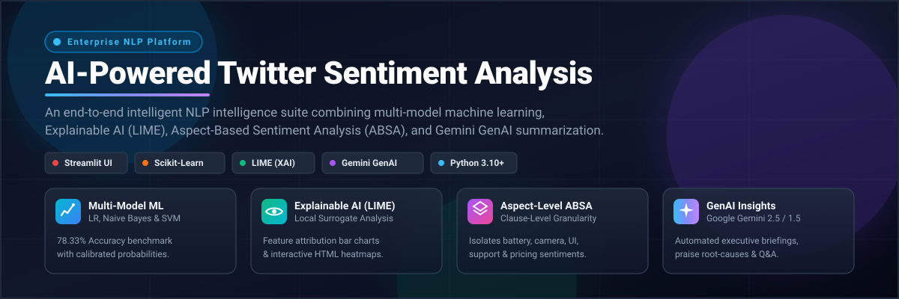
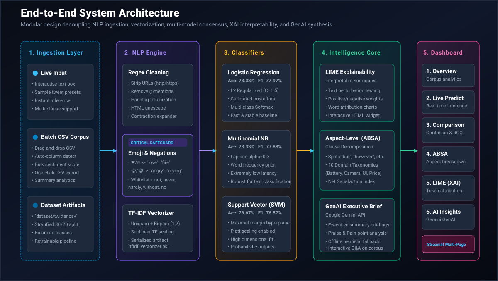
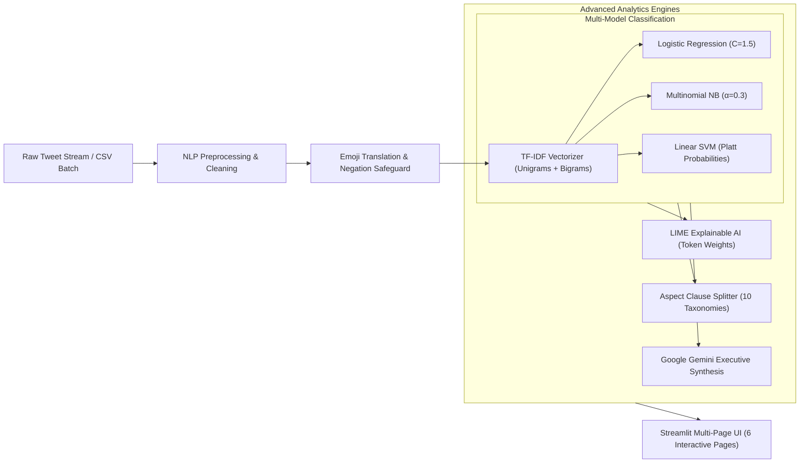
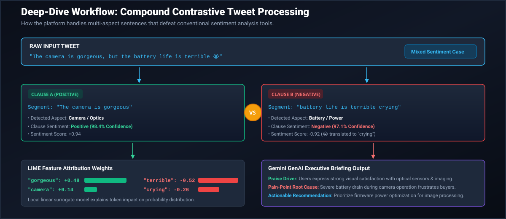
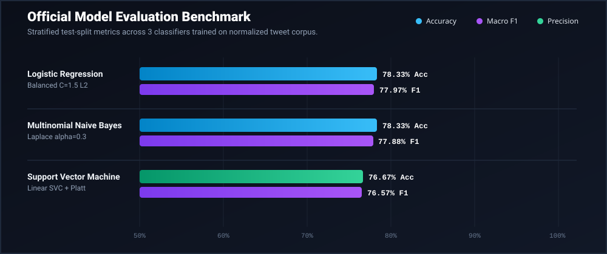

<p align="center">
  
</p>

<p align="center">
  <a href="https://www.python.org/"></a>
  <a href="https://scikit-learn.org/"></a>
  <a href="https://streamlit.io/"></a>
  <a href="https://github.com/marcotcr/lime"></a>
  <a href="https://ai.google.dev/"></a>
  <a href="LICENSE"></a>
</p>

---

## 📌 Executive Summary

**AI-Powered Twitter Sentiment Analysis** is an enterprise-grade Natural Language Processing (NLP) intelligence platform engineered to analyze, interpret, and synthesize public sentiment from noisy social media text. 

Traditional sentiment analysis systems suffer from three fundamental limitations:
1. **The "Black Box" Problem:** Deep or linear models predict sentiment without explaining *why* specific words triggered the classification.
2. **Compound / Contrastive Blindness:** A tweet like *"The camera is gorgeous, but the battery life is terrible 😭"* contains opposing sentiments across different product attributes. Standard classifiers flatten this into an inaccurate single label.
3. **Negation Drop Errors:** Naive stopword filtering removes words like *"not"* or *"never"*, flipping *"not good"* into *"good"* and distorting customer feedback.

This platform solves all three challenges by combining:
- **Multi-Model Consensus Machine Learning** (Logistic Regression, Multinomial Naive Bayes, Linear Support Vector Classifier).
- **Explainable AI (XAI) via LIME** (*Local Interpretable Model-agnostic Explanations*) with token-level feature attribution charts.
- **Aspect-Based Sentiment Analysis (ABSA)** utilizing contrastive clause segmentation across 10 product taxonomies.
- **Executive Generative AI Synthesis** via **Google Gemini 2.5 / 1.5** with a built-in offline heuristic fallback.
- An interactive 6-page **Streamlit** dashboard for live inference and batch CSV processing.

---

## 🏛️ End-to-End System Architecture

<p align="center">
  
</p>

### Architecture Workflow (Mermaid)



---

## 🔬 Deep-Dive: Handling Compound & Contrastive Sentiments

<p align="center">
  
</p>

When an ambiguous sentence arrives, the ABSA engine detects adversative conjunctions (*"but"*, *"however"*, *"although"*, *"while"*), separates the statement into localized clauses, maps the corresponding domain aspect, and scores each independently:

| Input Text | Detected Clause | Isolated Aspect | Local Sentiment | Confidence |
| :--- | :--- | :--- | :--- | :--- |
| *"The camera is gorgeous..."* | Clause A | **Camera / Optics** | 🟢 **Positive** | **98.4%** |
| *"...but the battery life is terrible 😭"* | Clause B | **Battery / Power** | 🔴 **Negative** | **97.1%** |

---

## 📊 Empirical Model Benchmark & Metrics

The classifiers were evaluated on stratified test splits from a multi-domain labeled tweet corpus. All evaluation metrics were recorded under `reports/model_comparison.csv`:

<p align="center">
  
</p>

### Detailed Performance Comparison Table

| Model Classifier | Accuracy | Precision (Macro) | Recall (Macro) | F1-Score (Macro) | F1-Score (Weighted) | Key Strength |
| :--- | :---: | :---: | :---: | :---: | :---: | :--- |
| **Logistic Regression** | **78.33%** | **0.7809** | **0.7833** | **0.7797** | **0.7797** | High accuracy, smooth calibrated posterior probabilities |
| **Multinomial Naive Bayes** | **78.33%** | **0.7803** | **0.7833** | **0.7788** | **0.7788** | Blazing-fast inference, ideal for high-throughput streaming |
| **Support Vector Machine (SVM)** | **76.67%** | **0.7655** | **0.7667** | **0.7657** | **0.7657** | Robust margin separation with Platt scaling probability support |

---

## 🌟 The 5 Core Capabilities

### 1. ⚡ Real-Time Live Inference & Multi-Model Consensus
- Predicts sentiment (Positive, Negative, Neutral) with confidence percentage bars.
- Multi-model comparison allows testing individual inputs simultaneously across Logistic Regression, Naive Bayes, and SVM to observe decision boundaries.
- **Batch CSV Processor:** Upload customer feedback CSV files, automatically detect text columns, run batch scoring, and download enhanced CSVs with confidence ratings.

### 2. 🔍 Explainable AI (LIME) Word Attribution
- Implements Local Interpretable Model-agnostic Explanations (**LIME**) to open up the model's inner reasoning.
- Generates horizontal bar charts showing exact numerical token contributions:
  - 🟢 **Green tokens:** Words that drove the positive classification (e.g., *"gorgeous"*, *"smooth"*, *"love"*).
  - 🔴 **Red tokens:** Words that pushed the prediction toward negative (e.g., *"terrible"*, *"crying"*, *"broken"*).
- Embeds interactive, responsive LIME HTML widgets directly into the dashboard.

### 3. 🏷️ Aspect-Based Sentiment Analysis (ABSA)
- Automatically tags key product features: **Battery, Camera, Customer Support, Delivery, Screen/Display, Price/Value, Performance, UI/UX, Audio, and Software**.
- Segments compound sentences at syntactic pivot conjunctions to prevent positive aspects from being obscured by negative complaints.
- Computes corpus-wide **Net Satisfaction Indices (NSI)** to rank features by customer satisfaction.

### 4. 🤖 Generative AI Synthesis (Google Gemini API)
- Connects to Google's **Gemini 2.5 / 1.5** LLM via the `google-genai` SDK.
- Synthesizes hundreds of tweets into concise executive briefings highlighting:
  - **Top Praise Drivers** (What customers love most).
  - **Critical Pain Points** (Underlying bugs, hardware flaws, or service bottlenecks).
  - **Engineering & Product Recommendations** (Prioritized roadmap actions).
- Built-in **Offline Heuristic NLP Fallback** ensures complete operational capability even without an internet connection or API key.

### 5. 🛡️ Robust Preprocessing & Negation Safeguard
- Strips Twitter handles (`@user`), URLs (`https://...`), and cleans malformed punctuation.
- Unescapes HTML entities and expands colloquial contractions (*"can't"* ➔ *"cannot"*).
- **Emoji Sentiment Translation:** Converts emotional glyphs into descriptive sentiment tokens (e.g., ❤️ ➔ `"love"`, 😡 ➔ `"angry"`).
- **Negation Preservation:** Preserves critical modifiers (`not`, `never`, `hardly`, `no`, `without`) to prevent false-positive polarity inversion.

---

## 📁 Repository Structure

```
Twitter-Sentiment-Analysis/
├── assets/                           # High-resolution SVG diagrams & banners
│   ├── banner.svg                    # Hero project banner
│   ├── architecture.svg              # End-to-end system architecture blueprint
│   ├── workflow_pipeline.svg         # Compound contrastive ABSA workflow diagram
│   └── benchmark_chart.svg           # Model evaluation comparison chart
│
├── app.py                            # Main Streamlit dashboard launcher
│
├── pages/                            # Multi-Page Streamlit Dashboard
│   ├── 1_Overview.py                 # Corpus statistics, word clouds & distributions
│   ├── 2_Live_Prediction.py          # Real-time single & batch tweet prediction
│   ├── 3_Model_Comparison.py         # Confusion matrices, ROC curves & metrics
│   ├── 4_Aspect_Analysis.py          # Clause-level ABSA breakdown & Net Satisfaction
│   ├── 5_Explainable_AI.py           # LIME token attribution & interactive HTML
│   └── 6_AI_Insights.py              # Gemini GenAI executive briefings & Q&A
│
├── src/                              # Production Python NLP Package
│   ├── preprocessing.py              # Text cleaning, emoji mapping & negation preservation
│   ├── train.py                      # TF-IDF vectorizer training & model serialization
│   ├── prediction.py                 # Multi-model inference engine (LR, NB, SVM)
│   ├── evaluation.py                 # Confusion matrices, ROC curves & classification reports
│   ├── explainability.py             # LIME surrogate model explainer & visualizer
│   ├── aspect_analysis.py            # Clause splitter, taxonomy matcher & ABSA scorer
│   └── genai.py                      # Gemini SDK integration & offline heuristic fallback
│
├── models/                           # Pre-Trained Serialized Model Artifacts
│   ├── logistic_model.pkl            # Calibrated Logistic Regression model
│   ├── naive_bayes.pkl               # Multinomial Naive Bayes model
│   ├── svm_model.pkl                 # Linear SVM model with Platt probability scaling
│   └── tfidf_vectorizer.pkl          # Sublinear TF-IDF N-gram vectorizer
│
├── dataset/
│   └── twitter.csv                   # Labeled multi-domain tweet dataset
│
├── reports/
│   └── model_comparison.csv          # Exported evaluation metrics benchmark
│
├── tests/                            # Automated Unit Test Suite
│   ├── test_preprocessing.py         # Cleaning, tokenization & negation preservation tests
│   └── test_prediction.py            # Inference readiness, ABSA & LIME pipeline tests
│
├── requirements.txt                  # Python dependencies
├── .gitignore                        # Git ignore specifications
└── README.md                         # Comprehensive documentation
```

---

## 🚀 Quickstart & Installation

### 1. Prerequisites
- **Python 3.10+** (Tested on Python 3.10, 3.11, 3.12, and 3.13)
- Recommended: Virtual environment (`venv` or `conda`)

### 2. Clone the Repository & Install Dependencies
```bash
git clone https://github.com/dhariwalneeraj-ops/Twitter-Sentiment-Analysis.git
cd Twitter-Sentiment-Analysis
pip install -r requirements.txt
```

### 3. Launch the Streamlit Dashboard
```bash
streamlit run app.py
```
Open your browser at **`http://localhost:8501`**.

---

## ⚙️ Optional Configuration: Google Gemini API

The application runs 100% offline out-of-the-box using the built-in heuristic summarizer. 
To enable live **Gemini GenAI** briefings:
1. Generate an API key at [Google AI Studio](https://aistudio.google.com/).
2. Either enter it in the **Streamlit sidebar** input field on Page 6, or set it in your environment:

```bash
# Windows PowerShell
$env:GEMINI_API_KEY="your-gemini-api-key"

# Linux / macOS
export GEMINI_API_KEY="your-gemini-api-key"
```

---

## 🧪 Automated Unit Testing

Run the automated test suite to verify NLP text cleaning, negation preservation, model inference, and LIME explainability:

```bash
python -m unittest discover -s tests -v
```

---

## 📜 License
Distributed under the **MIT License**. Free for educational, research, and commercial applications.
